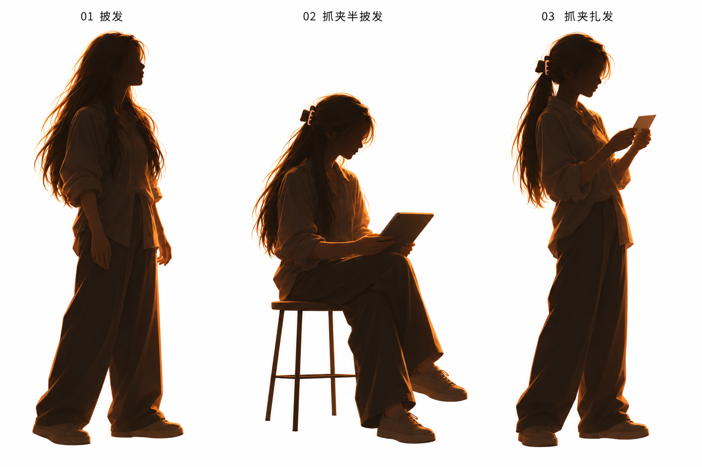
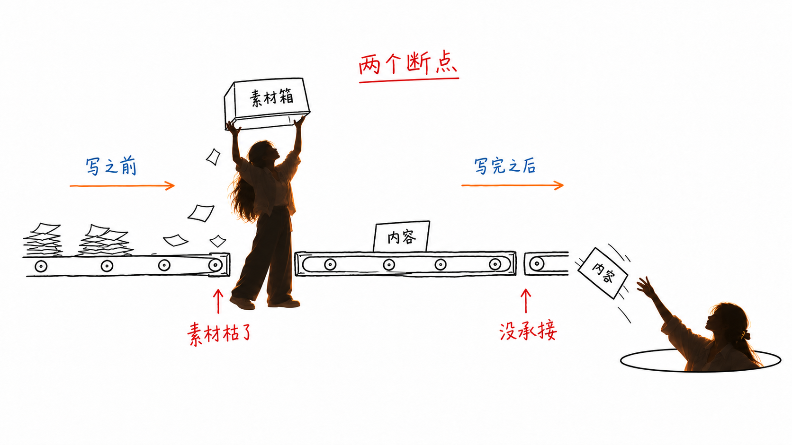
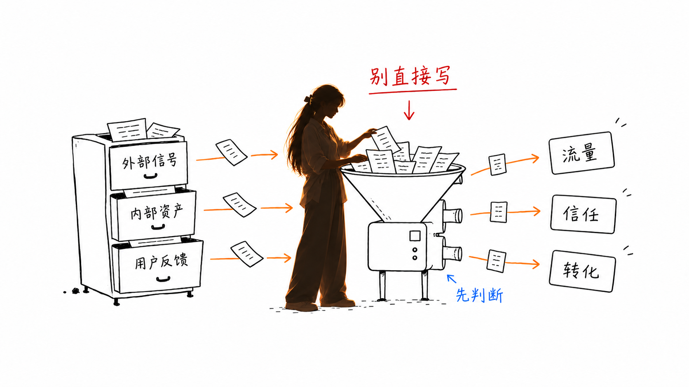
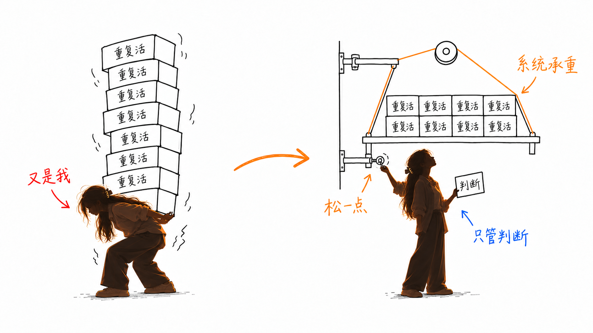

# Lucía Illustrations

用深色半剪影人物、局部暖橙光与黑色手绘物件，为中文文章、英语学习笔记和个人思考生成正文配图。

人物主参考：



## 已完成的改造

- Skill 目录与调用名：`lucia-illustrations` / `$lucia-illustrations`。
- IP：自然成年女性、柔和略圆侧脸、长黑发，支持披发、抓夹半披发、低位抓夹扎发；眼镜可选，不带包包。
- 风格：深炭黑／黑褐半剪影、局部暖橙受光，正文默认白底留白与简洁手绘物件。
- 同步更新入口、人物定义、画风、构图、提示词、验收规则、界面元数据与调用示例。
- 替换两处展示／运行时样图为 14 张 Lucía 改编图，保持完整编号。
- 原版禁止一切渐变、阴影、橙色只限箭头等规则已调整；人物局部柔和受光允许，正文背景仍保持白色。

## 自然姿态更新

主参考采用平视、低头看平板、看手中卡片三种自然姿态，发型不绑定动作。生成时先确定任务对象与视线，再决定头颈和身体动作；暖光独立指定。已校正 02、06、07、09、11、12 六张样图，有具体高处目标的抬头仍可使用。

## 使用

真正需要安装的是本仓库内的 `lucia-illustrations/` 子目录，不是外层仓库目录。把该子目录放到所用客户端的技能目录后，用：

```text
Use $lucia-illustrations 为下面这篇文章生成 3 张正文配图。让人物承担核心动作，保持白底与局部暖橙光。

<粘贴正文>
```

只做规划时明确说“先不要生图”。需要逐张确认时明确说“先给方案，等我确认后再生成”。更多调用见 [examples/prompts.md](examples/prompts.md)。

本仓库已用 `lucia-illustrations/` 替换旧 `ian-xiaohei-illustrations/` Skill。安装时请选择新目录，避免两套规则并存。

## 关键文件

- [Skill 入口](lucia-illustrations/SKILL.md)
- [人物 IP 定义与关键词](lucia-illustrations/references/lucia-ip.md)
- [风格 DNA](lucia-illustrations/references/style-dna.md)
- [提示词模板](lucia-illustrations/references/prompt-template.md)
- [验收清单](lucia-illustrations/references/qa-checklist.md)
- [14 张样板图索引](lucia-illustrations/references/examples-index.md)
- [独立图集](examples/index.html)

## 样板预览







样图校准结构与人物参与方式，不是默认照抄的构图模板。个别人物比线稿物件更立体，受光强度、细节和比例也有变化；生成新图时按文字规范检查，不能照搬这些偏差。

## 来源与许可

改编自 Ian 的 [Ian Xiaohei Illustrations](https://github.com/helloianneo/ian-xiaohei-illustrations)，基于用户 fork 的提交 `4102eb807f03bcb6e538a16e8b31b41db8b5b954`。图像由内置 image_gen 根据原样板与用户确认的角色参考生成。保留原 MIT 许可与 Ian 归属，见 [LICENSE](LICENSE) 和 [NOTICE.md](NOTICE.md)。
